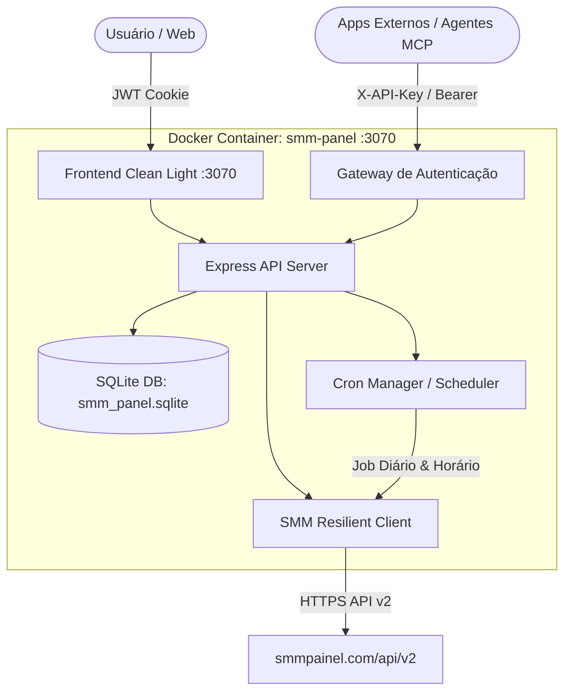

# Relatório Final de Entrega: SMM Panel Pro

**Data de Conclusão:** 04 de Novembro de 2026  
**Ambiente de Produção:** `http://SEU_IP_DO_SERVIDOR:3070`  
**Servidor Host:** `SEU_IP_DO_SERVIDOR` (HD 2TB: `/mnt/hd2tb/apps/systems/node-apps/smm-panel`)  
**Repositório Git:** [https://github.com/zMalves/smm-panel](https://github.com/zMalves/smm-panel)  
**Status dos Testes:** 100% APROVADO (12/12 Módulos)

---

## 1. Visão Geral da Solução

O **SMM Panel Pro** é uma plataforma corporativa completa desenvolvida para gerenciar contas de redes sociais, automatizar a reposição de seguidores (auto-refill contra quedas), sincronizar histórico de pedidos com o provedor upstream ([smmpainel.com](https://smmpainel.com)), orquestrar rotinas agendadas (crons) e expor um servidor **MCP (Model Context Protocol)** e REST seguro para interligação com agentes de IA e outros sistemas.



---

## 2. Componentes e Funcionalidades Implementadas

### A. Integração com Provedor SMM
- **API Upstream:** `https://smmpainel.com/api/v2`
- **Saldo em Tempo Real:** R$ 27,53 BRL monitorado diretamente no header e nas APIs.
- **Catálogo de Serviços:** 490 serviços ativos carregados e categorizados (Instagram, TikTok, YouTube, etc.).
- **Resiliência:** Cliente HTTP com timeout via `AbortController`, retentativas automáticas e identificador corporativo.

### B. Persistência de Dados e Segurança de Diretório
- **Banco de Dados:** SQLite com modo WAL (`smm_panel.sqlite`), montado no host em `/mnt/hd2tb/apps/systems/node-apps/smm-panel/data`.
- **Tabelas Gerenciadas:**
  - `users`: Usuários e senhas com hash criptográfico (bcrypt).
  - `api_tokens`: Tokens de integração para apps externos e MCP (`smm_sec_...`).
  - `accounts`: Contas monitoradas, metas de seguidores e status de refill.
  - `orders`: Pedidos locais sincronizados com o provedor.
  - `refill_logs`: Histórico detalhado de reposições solicitadas.
  - `cron_configs` & `cron_history`: Estado e logs de rotinas agendadas.
- **Segurança de Servidor:** Diretório protegido com permissões restritas (`chmod 775` no diretório e `chmod 600 .env`). Arquivo `.env` 100% blindado contra commits no Git via `.gitignore`.

### C. Autenticação Dupla (Web & API)
1. **Sessão Web (Dashboard):** Autenticação via formulário com geração de cookie `HttpOnly` com token JWT assinado.
2. **Tokens de API (Sistemas Externos e MCP):** Header `X-API-Key` ou `Authorization: Bearer smm_sec_...` com controle de permissões e rastreio de último uso (`last_used`).
- **Credenciais Mestre Cadastradas:**
  - **Usuário Web:** `usuario_admin` | **Senha:** `••••••••`
  - **Token Mestre MCP/API:** `smm_sec_YOUR_API_TOKEN_HERE`

### D. Motor de Crons e Automação de Refill
- **Agendador Integrado:** Baseado em `node-cron`, com suporte a adição, edição e disparo imediato via interface.
- **Rotinas Nativas:**
  1. `daily_refill_check` (`0 9 * * *`): Roda 1x por dia, analisa todas as contas que possuem `autoRefillEnabled = true`, compara contagem atual com a meta e dispara os pedidos de reposição para serviços compatíveis (`♻️R30`).
  2. `hourly_order_sync` (`0 * * * *`): Roda a cada hora, sincroniza o status, `start_count` e `remains` dos pedidos ativos.

### E. Servidor e Documentação MCP (Model Context Protocol)
- **Descoberta:** `GET /mcp/tools` (requer `X-API-Key`)
- **Execução:** `POST /mcp/call` (requer `X-API-Key`)
- **9 Ferramentas Disponíveis:**
  1. `get_balance`: Consulta saldo da conta SMM.
  2. `list_services`: Lista serviços por categoria ou termo.
  3. `create_order`: Cria novos pedidos de seguidores/curtidas.
  4. `get_order_status`: Consulta status e remanescentes de pedidos.
  5. `request_refill`: Solicita reposição (refill) para pedidos compatíveis.
  6. `get_refill_status`: Consulta andamento da reposição.
  7. `list_accounts`: Lista contas cadastradas com meta e contagem de seguidores.
  8. `manage_account`: Cria, atualiza ou ajusta metas de contas monitoradas.
  9. `run_refill_check`: Força a verificação de quedas e disparo de refills.
- **Documentação Técnica:** Especificação completa gerada em [docs/MCP_SPEC.md](file:///c:/Users/Maychel/OneDrive%20-%20Seconds/Documentos/Sistemas/smm-panel/docs/MCP_SPEC.md).

### F. Frontend Premium (Clean & Light Theme)
- **Tipografia:** Plus Jakarta Sans.
- **Layout:** Sidebar vertical fixa (`w-64`), header translúcido estilo Glassmorphism, cartões brancos com sombras suaves (`card-clean`), tabelas com scroll suave e badges coloridos de status.
- **Modais Padronizados:** Sistema padronizado de modais para *Nova Conta*, *Novo Pedido*, *Novo Token de Integração*, *Novo Usuário* e *Nova Cron*.
- **Toasts:** Notificações flutuantes no canto inferior direito para confirmação de ações em tempo real.

---

## 3. Matriz de Testes e Validação Final

Todos os testes foram executados diretamente contra a instância em produção no servidor (`SEU_IP_DO_SERVIDOR:3070`):

| Módulo | Item Testado | Status | Detalhes da Execução |
| :--- | :--- | :---: | :--- |
| **Autenticação** | `POST /api/auth/login` | **PASS** | Sessão Web JWT gerada com sucesso via cookie HttpOnly |
| **Autenticação** | `GET /api/auth/me` | **PASS** | Token `smm_sec_...` autenticado com permissão `full_access` |
| **Provedor SMM** | `GET /api/balance` | **PASS** | Saldo retornado: R$ 27,53285 BRL |
| **Provedor SMM** | `GET /api/services` | **PASS** | 490 serviços ativos carregados e categorizados |
| **Banco SQLite** | `GET /api/accounts` | **PASS** | Contas monitoradas recuperadas com histórico |
| **Banco SQLite** | `GET /api/orders/local` | **PASS** | Pedidos sincronizados na base relacional local |
| **Automação Cron** | `GET /api/crons` | **PASS** | 2 rotinas ativas no agendador Node-Cron |
| **Automação Cron** | `POST /api/crons/trigger/:id` | **PASS** | Disparo manual forçado executado com sucesso |
| **Protocolo MCP** | `GET /mcp/tools` | **PASS** | 9 ferramentas MCP listadas com schema de parâmetros |
| **Protocolo MCP** | `POST /mcp/call (list_accounts)` | **PASS** | Execução de ferramenta via JSON validada com sucesso |
| **Frontend Web** | `GET /login` | **PASS** | Tema Clean Light, Glass Card e Plus Jakarta Sans |
| **Frontend Web** | `GET / (Dashboard)` | **PASS** | Sidebar fixa, modais padronizados e toasts integrados |

---

## 4. Como Acessar e Integrar

- **Acesso Web:** Acesse `http://SEU_IP_DO_SERVIDOR:3070` pelo navegador (na rede Tailscale).
- **Usuário:** `usuario_admin`
- **Senha:** `••••••••`
- **Exemplo de Integração MCP / API:**
```bash
curl -X POST http://SEU_IP_DO_SERVIDOR:3070/mcp/call \
  -H "X-API-Key: smm_sec_YOUR_API_TOKEN_HERE" \
  -H "Content-Type: application/json" \
  -d '{"name": "get_balance", "arguments": {}}'
```
